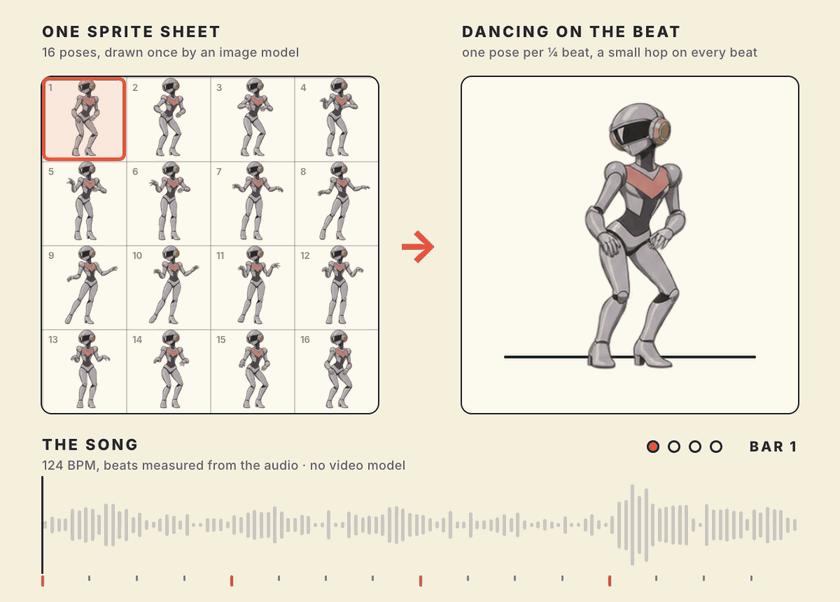

<h1 align="center">onbeat</h1>

<p align="center"><strong>Give your coding agent a song. Get back a beat-synced lyric reel.</strong></p>

https://github.com/user-attachments/assets/9c17b8b5-f133-4ccc-b93c-af4cd57e193e

<p align="center"><sub>Four styles in motion: paper cut, pixel art, handmade clay and 1980s anime. Original characters, expressive faces and a beat measured from the song.</sub></p>

The bundled example is a **34.6-second animation showcase**. Each style gets its own sequence of grounded full-body choreography and genuine face-dancing close-ups. The close-ups are new 3×3 head-and-shoulder drawings with nods, eye changes and expressions; they aren't enlarged body sprites. The anime sequence combines hand-inked '80s cels, a blue-hour city-pop rooftop and a longer face-led finish. Layered scenery gives each world depth, and the music drives the cuts and weight shifts.

**Turn on sound** in the video above to hear the song and beat-aligned animation. [Render the bundled example yourself](#try-it-without-an-agent).

onbeat is a skill for **Claude Code** and **Codex**. It teaches your agent to measure the beats and sung words of a song and to write a [HyperFrames](https://hyperframes.heygen.com) scene that moves on those times. The result is a vertical 1080×1920 MP4 for Reels, Shorts and TikTok.

<p align="center"></p>

<p align="center"><sub>How it works: a pose sheet becomes a dancer, with the animation driven by measured beats. The robot illustrates the process; the video above shows the finished four-style example.</sub></p>

## Old-school animation, much cheaper to iterate

Generate the artwork once. Animate it as many times as you like.

The dancers are **sprite sheets**, not generated video clips. An image model draws 16 body poses per character and, for face dancing, a separate sheet of nine close-up poses. onbeat then steps through those drawings on beats measured from the song, layers them with scenery, and renders the result locally with HyperFrames. The same character art stays consistent across every scene, and the motion clock stays tied to the music.

This is where the cost advantage comes from: **changing the timing, swapping a background, moving a dancer, editing the lyrics or re-rendering existing artwork requires zero additional image or video generation calls.** You can switch between styles, cut from body animation to face animation and revise the choreography without generating a new video clip for every scene or revision. Local renders still use your computer; making new artwork may use provider credits.

| What changes | With onbeat's reusable artwork |
| --- | --- |
| A move lands late | Adjust the measured timing or choreography and render again. |
| The scene needs more depth | Move the background, dancers and foreground props independently. |
| Another style joins the cast | Add its pose sheet; keep the existing cast and timing. |
| The lyrics, layout or cut needs revision | Edit the scene and render again with the same images. |

Getting several consistent characters, precise beat timing and matching scene changes from generated video can take repeated clip generation and selection. onbeat makes those choices explicit in code instead. That makes iteration much cheaper when you reuse artwork; the exact saving depends on the image/video providers and number of revisions. This is a workflow advantage, not a measured price benchmark.

The tradeoff is deliberate: this looks like assembled, pose-based animation. It is built for rhythmic dancing and stylized worlds; it does not simulate continuous cinematic character motion.

## Install

**Any agent, one command** ([skills.sh](https://skills.sh))

```bash
npx skills add latent-spaces/onbeat
```

It asks which agents to install for (Claude Code, Codex and others) and copies the skill into your project. Add `-g` to install it for all projects.

**Claude Code plugin**

```text
/plugin marketplace add latent-spaces/onbeat
/plugin install onbeat@onbeat
```

**Codex plugin**

```bash
codex plugin marketplace add latent-spaces/onbeat
codex plugin add onbeat@onbeat
```

Or copy the [`skills/onbeat`](skills/onbeat) folder into your agent's skills folder. It is self-contained.

## Use it

Ask in plain words:

> Render the onbeat example.

> Make a beat-synced reel for ~/Downloads/my-song.mp3. Neon city at night, karaoke lyrics.

The agent measures the song, then works with you on the concept and a simple story. Supply reference images if you have them: they can guide the actual character/style or provide context. You choose between rough visual directions before production assets are made. A short dancing draft comes next; you review it with sound, then the agent iterates and extends the agreed direction into the full reel.

Higgsfield and Codex's built-in image generator are the main image routes. In Codex, the built-in generator is the default. Dancing avatars keep the character design you approved; friends can join on measured bar downbeats.

## Try it without an agent

The example renders by itself. You need Node 22+ and ffmpeg, and no keys or accounts.

```bash
git clone https://github.com/latent-spaces/onbeat && cd onbeat/skills/onbeat/example
```

```bash
npx --yes hyperframes@0.9.2 render --output out/example.mp4
```

The first render downloads HyperFrames and a headless browser once.

## How it works

```
song.mp3 ──► timing.py ──► timing.js ──► the scene your agent writes ──► HyperFrames ──► reel.mp4
```

There are two clocks, both measured from the audio. The **beat clock** drives the pulses, cuts and dance poses. The **voice clock** drives the lyrics. Every frame is a pure function of the song time, so a render comes out the same every time.

The design of each scene is left to the agent, so the reels get better as models do. The measuring is code, because a model can't hear the beat.

## What's inside

```
skills/onbeat/
  SKILL.md      the method: measure, write one scene, check the sync, render
  references/   render rules, beat motion, character sprites
  scripts/      timing.py (beats, bars, words) and sprites.py (checks character sheets)
  example/      a complete 34.6-second showcase to copy and rewrite
```

The bundled example is the reproducible four-style animation showcase. It includes the original cast, separate scenery layers, source artwork and prompts; no image-generation account is needed to render it.

## Setup, data and costs

The agent reads your audio/reference files, writes a reel folder and runs local analysis and rendering commands. Rendering needs Node 22+ and ffmpeg; beat analysis adds a Python environment with the pinned dependencies in `scripts/requirements.txt`. Optional word alignment uses a separate Python 3.12 environment and large local speech/separation models. First use downloads packages, a headless browser, models and potentially fonts; the audio-analysis scripts themselves run locally. Your coding agent's data handling depends on its provider and settings. Image generation sends prompts and supplied reference images to the selected provider and may use credits. The skill asks before paid generation and does not publish your reel. Details are in [PRIVACY.md](PRIVACY.md).

## Limits and verification

The beat tracker assumes one fixed tempo and defaults to four beats per bar. Kick-based downbeat/section detection suits a clear regular drum pulse; changing tempo, unusual meters, weak percussion and expressive vocals need closer review. Word recognition and alignment can miss or mishear lyrics, so inspect the sync overlay and disclose estimated words. A visual review is not an independent numeric proof of beat accuracy.

Run `node --test tests/` for the helper regressions and `bash skills/onbeat/scripts/smoke.sh` for a scratch-copy check, render and MP4 probe.

## Status

This is an early release (v0.2). The bundled example and helper tests pass. An assisted unfamiliar-song session exercised concept choices, reference-led character graphics, a short three-character dancing draft and a visual revision. It required intervention, so it is not an unedited first-try result. Clean installs from GitHub were checked for the Claude Code plugin, the Codex plugin and `npx skills add`; from the clean Claude Code install, a headless agent rendered the example unaided. A fresh word-alignment install, broad genre coverage, independent repeatability and a controlled with/without-OnBeat comparison remain unverified. The Higgsfield sprite route only prints its commands.

## Credits and licence

- **MIT licence.** See [LICENSE](LICENSE). Third-party components retain their own licences.
- The sprite-sheet approach is adapted from [page-mascot](https://github.com/nilbuild/page-mascot) by Kamran Ahmed (MIT). See [THIRD_PARTY_NOTICES.md](THIRD_PARTY_NOTICES.md).
- [HyperFrames](https://hyperframes.heygen.com) by HeyGen renders the video and GSAP drives the timeline. Word alignment uses WhisperX, faster-whisper and Demucs.
- The song "allow always" was made with Suno by the repo owner.
