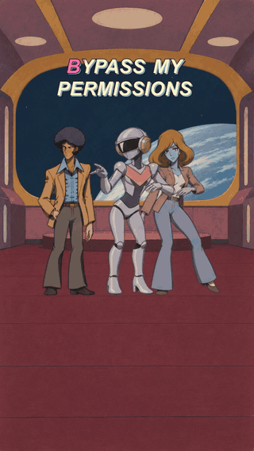

<p align="center">
  
</p>

<h1 align="center">music-reels</h1>

<p align="center"><strong>Song in, beat-synced lyric reel out. Your coding agent does the edit.</strong></p>

<p align="center">
  A Claude Code + Codex skill and a small CLI that measure a song's beats and sung words and drive a <a href="https://hyperframes.heygen.com">HyperFrames</a> reel from them. The output is a vertical 1080×1920 MP4, ready for Reels, Shorts and TikTok.
</p>

<p align="center"><sub>Above: a silent 7 s preview of the 11.5 s bundled sample (chorus of "allow always"). Status: <b>early release (v0.1)</b>.</sub></p>

<!-- OWNER: upload the three local clips as GitHub user-attachments, then replace each
     placeholder with its URL on its own line. GitHub will render players with audio.
     Local files (ignored, not committed): out/readme/disco.mp4 (9.6 s, 4.2 MB),
     out/readme/terminal.mp4 (9.6 s, 1.8 MB), out/readme/sample.mp4 (11.5 s, 3.9 MB).
     Do not paste a repository file URL; use the user-attachments upload URL. -->

**"allow always"** — the disco finale, with sound:

DISCO_VIDEO_URL_PLACEHOLDER

**Same song, the terminal look:**

TERMINAL_VIDEO_URL_PLACEHOLDER

**The bundled sample** — 11.5 seconds, exactly what `make sample` renders:

SAMPLE_VIDEO_URL_PLACEHOLDER

---

## Quickstart

```bash
git clone https://github.com/oronanschel/music-reels && cd music-reels
make doctor   # checks node, npx, ffmpeg, python3 and the render browser; prints a fix for anything missing
make sample   # renders the bundled sample -> out/sample.mp4 (no keys, no accounts)
```

The first render downloads HyperFrames and a headless browser once. With those cached, the render step took about 11–38 s on an Apple M4 laptop, and a full `make sample` including checks took up to about 2 minutes. Cold-install time isn't measured yet. Step-by-step, with the expected output for each step: **[docs/TRY-IT.md](docs/TRY-IT.md)**.

### Use it from your agent

<sub>The install commands follow the Claude Code and Codex plugin formats, and their syntax was checked. A fresh install has not been tested yet.</sub>

**Claude Code**

```text
/plugin marketplace add oronanschel/music-reels
/plugin install music-reel@music-reels
```

Then: *"Render the music-reels sample"* or *"Make a beat-synced reel for songs/my-song"*.

**Codex**

```bash
codex plugin marketplace add oronanschel/music-reels
codex plugin add music-reel@music-reels
```

Or open the cloned repo in Codex. It reads `AGENTS.md` and `.agents/skills/music-reel/` by itself.

**Any agent:** point it at [`skills/music-reel/SKILL.md`](skills/music-reel/SKILL.md).

## Make a reel for your own song

```bash
mkdir -p songs/my-song && cp ~/Downloads/my-song.mp3 songs/my-song/song.mp3
make setup                     # once: Python .venv with pinned requirements
make timing SONG=my-song       # beats only: BPM, beats, bars, sections, kick
make render SONG=my-song       # template reel -> out/my-song.mp4
```

Add `WORDS=1` to `make timing` for word-by-word karaoke (run `make setup-align` once and put the sung lyrics in `songs/my-song/lyrics.txt`; add `FORCE=1` to replace an existing beats-only timing). The audio can also be `.m4a`, `.wav`, `.flac`, `.ogg` or `.aiff`, or you can pass `AUDIO=/path/to/file`. Repeated renders go to `out/my-song-2.mp4` and so on. Change the title, palette, captions and cast in `songs/my-song/reel.json`. You don't need to edit any HTML.

## What you get

- **Beat and word timing**: a fixed-tempo beat grid, downbeats, kick/no-kick sections and envelopes. Sung-word alignment is optional (`scripts/timing.py`, `scripts/align_words.py`).
- **A song-agnostic template** (`video/template/`): a reel driven by `timing.json` plus a small `reel.json`.
- **Beat-synced character motion**: a pose per beat, a bounce on the kick, an accent on the bar downbeat, and a phase offset per character ([docs/beat-motion.md](docs/beat-motion.md)).
- **Sprite generation with one asset contract**: Codex built-in image generation, or Higgsfield (an adapter that only prints its commands; untested). Both write `sprites.json`, with keying plus alpha and drift checks ([docs/sprites.md](docs/sprites.md)).
- **A sync-check overlay**: beat ticks and word marks in preview, so you can check timing before a long render.
- **The full story of a finished reel**: [GUIDE.md](docs/GUIDE.md) shows how the 2:24 "allow always" video was made, with prompts, commands, dead ends and the human–agent feedback loop.

## How it works

```
 song.mp3 ──► make timing ──► timing.json ─┐
 (Suno or any)  beats · bars · words       │
                                           ├─► video/template ──► make render ──► out/<song>.mp4
 reel.json ────────────────────────────────┘    HyperFrames + GSAP    1080×1920
 title · palette · captions · cast              beat clock + voice clock
        ▲
 sprites.json ◄── docs/sprites.md (Codex image gen / Higgsfield)
```

There are two clocks. The **beat clock** drives pulses, cuts and dance poses. The **voice clock** drives the lyrics. Every visual is a pure function of timeline time, so a render is identical every time.

## Repository map

| Path | What |
|---|---|
| `skills/music-reel/` | the agent skill and the sprite tool (installed by the Claude Code and Codex plugins) |
| `Makefile`, `scripts/` | `make doctor`, `sample`, `timing`, `render` and the scripts behind them |
| `video/src/` | shared helpers: beat timing, sprite dance, sync-check overlay |
| `video/template/` | the reel that works for any song |
| `video/sample/` | the bundled no-key sample (`make sample`) |
| `video/assets/disco/` | shared sprite sheets used by the sample and the hero |
| `video/allow-always-final/`, `songs/allow-always/` | the hero reel and what it needs to rebuild |
| `docs/` | GUIDE (how the hero was made, timing contract), TRY-IT, beat motion, sprites, history |

Research and process notes (reference-reel analysis, playbook, runbooks, team research, early prototypes) live on the [`archive` branch](https://github.com/oronanschel/music-reels/tree/archive).

## Credits and licence

- **Licence: not chosen yet.** See [LICENSE](LICENSE). Until the owner picks one, no reuse rights are granted.
- Sprite-atlas approach adapted from [page-mascot](https://github.com/nilbuild/page-mascot) by Kamran Ahmed (@nilbuild), MIT licence; see [THIRD_PARTY_NOTICES.md](THIRD_PARTY_NOTICES.md). The reel's dance and action art was generated separately.
- **HyperFrames** by HeyGen renders the video. **GSAP** drives the timeline. Word alignment uses **WhisperX**, **faster-whisper** and **Demucs**.
- The song "allow always" was made with Suno by the repo owner.

History of the project before packaging: [docs/history.md](docs/history.md).
